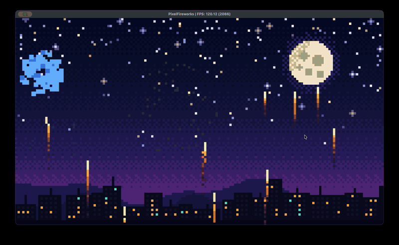

# Pixel Fireworks

A silent pixel-art fireworks show for PS5 homebrew, written in C++ with
[AnyDevKit](https://github.com/boykopovar/AnyDevKit). It is an example from
[AnyDevStudio](https://github.com/AnyDevStudio).



Everything in the game is drawn by code. There are no image files in the game itself:

- The night sky is a 160x90 grid of 12-pixel cells, with a dithered gradient, stars, a moon and a city.
- Rockets rise and burst into blocky particles with gravity and a stepped color fade.
- Everything is snapped to the same 12-pixel grid.
- About 16,400 quads go to the GPU in a single draw call each frame, with nothing allocated in the frame loop.

## Where it has run

It ran at about 119 FPS in the AnyPS5 compatibility layer on an Apple Silicon Mac, on a manually
adjusted copy of the build: the current relinker cannot handle this binary's memory layout directly.
It has not been run on a real PS5.

## Build

You need the [AnyDevKit SDK](https://github.com/boykopovar/AnyDevKit/releases/latest), CMake, Ninja, LLD
and Clang 18 or newer. `CMakePresets.json` holds paths on your machine, so make it with `adk init`:

```sh
adk setup .adk --target ps5
adk init PixelFireworks --deps .adk --directory preset-source
cp preset-source/CMakePresets.json .

cmake --preset ps5
cmake --build --preset ps5
adk package --target ps5
```

The package is written to `dist/ps5/PixelFireworks.ffpfsc`. The prepared folder is `build/package/app0`.

## Where to look

- `src/Simulation/NightSky.cpp`: builds the sky.
- `src/Simulation/Fireworks.cpp`: the rockets and particles.
- `include/Simulation/Budget.hpp`: the quad budget.
- `src/Graphics/Renderer.cpp`: draws the quads with AGC.
- `tests/SimulationTest.cpp`: checks the simulation on a desktop computer.

## Credits and license

Built on [AnyDevKit](https://github.com/boykopovar/AnyDevKit) by
[boykopovar](https://github.com/boykopovar). The project started from AnyDevKit's `adk init` template, so
it is licensed under the [GNU General Public License v2.0 only](LICENSE), like AnyDevKit.

The home screen background `pic0.png` was generated with Google Gemini.

This is an independent homebrew project, not affiliated with or endorsed by Sony Interactive
Entertainment. PlayStation and PS5 are trademarks of their respective owner.
